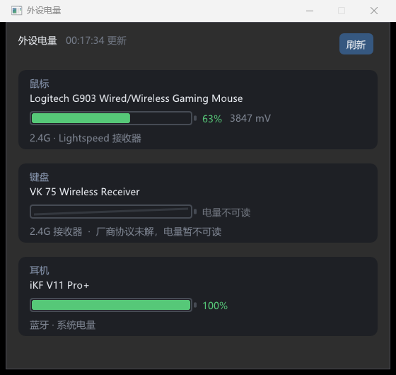

# 2.4G-battery-viewer

Windows 上显示鼠标 / 键盘 / 耳机电量的桌面小工具。C++20 + Win32 + Direct3D 11 + Dear ImGui。



## 当前状态

| 设备 | 电量 | 说明 |
|---|---|---|
| Logitech G903（Lightspeed 接收器） | ✅ 可读 | HID++ 2.0 特征 `0x1001` BATTERY_VOLTAGE |
| Valkyrie VK75-Loki（2.4G） | 🟡 不可读 | 厂商私有协议，尚未解出电量字段 |
| iKF V11 Pro+（蓝牙） | ✅ 可读 | 读 Windows 采集的蓝牙电量（PnP 属性 `{104EA319-…},2`） |

两种通用通路，按顺序尝试：

1. **蓝牙 LE GATT Battery Service**（`0x180F` / 特征 `0x2A19`）——设备必须真的广告 BLE。
2. **Windows 已采集的蓝牙电量**——读蓝牙 PnP 设备节点上的属性
   `{104EA319-6EE2-4701-BD47-8DDBF425BBE5}, 2`（BYTE，0..100）。
   Windows 自己（设置 → 蓝牙和设备）能显示电量时，这个属性就有值，
   **经典蓝牙（A2DP/HFP）耳机也适用**，iKF 就是走这条。

界面上三台设备都会被识别并显示型号，读不到电量的会明确写出原因，不会假装有数据。

协议探测的完整记录见 [docs/PROTOCOL-NOTES.md](docs/PROTOCOL-NOTES.md)。

## 构建

需要 Visual Studio 2022/2026 的 MSVC（含 Windows SDK 10）。

```powershell
.\build.ps1            # 全部：battery_viewer / probe / rawprobe / hidpp
.\build.ps1 -Target app
.\build.ps1 -Clean
```

产物在 `out\`。命令行工具：

```
out\battery_viewer.exe     # 主程序
out\probe.exe              # 枚举 HID 集合、打印报告描述符、被动读报文
out\rawprobe.exe           # 发任意 HID 报文、收应答
out\hidpp_probe.exe        # 枚举罗技 HID++ 特征表
```

> `build.ps1` 直接调用 `cl.exe`。`CMakeLists.txt` 也在，供 CLion 使用；
> 在受限沙箱里 CMake 会卡在编译器探测（需要管道收集子进程输出），
> 那时请用 `build.ps1`。

## 运行

```
out\battery_viewer.exe
```

后台线程每 5 秒刷新一次，右上角「刷新」可手动触发。
电压按单节锂电曲线换算成百分比，是**估算值**，卡片上同时给出原始 mV。

## 目录结构

```
src/
  app_main.cpp      Win32 + D3D11 + ImGui 主循环与界面
  providers.cpp     设备枚举与电量读取（后台线程调用）
  providers.h
  ble_battery.cpp   蓝牙 LE GATT Battery Service 读取（C++/WinRT）
  ble_battery.h
  bt_pnp_battery.cpp 读 Windows 采集的蓝牙电量（SetupAPI 设备属性）
  bt_pnp_battery.h
  device.h          DeviceInfo / 状态枚举 / 电压换算
  probe_main.cpp    HID 枚举与描述符导出工具
  rawprobe.cpp      原始报文收发工具
  hidpp_probe.cpp   HID++ 特征表枚举工具
  ikf_probe.cpp     iKF 全集合写/听探测工具
third_party/
  hidapi/           HID 访问（vendored，仅 Windows 后端）
  imgui/            Dear ImGui v1.93.0（vendored）
tools/
  capture.ps1       窗口截图（PrintWindow）
docs/
  HANDOFF.md        交接说明：当前状态、下一步、环境坑、工具用法
  PROTOCOL-NOTES.md 协议探测记录
  IKF-PROTOCOL.md   iKF 官方 HID 协议逆向结果
```

> 隔一段时间再回来，先读 [docs/HANDOFF.md](docs/HANDOFF.md)。

蓝牙部分用 C++/WinRT，头文件随 Windows SDK 提供，链接 `WindowsApp.lib`，不需要 NuGet 或 vcpkg。

## 已知限制

- 电压到百分比的曲线是通用锂电近似，不是罗技官方曲线，可能与 G HUB 显示有偏差
- G903 休眠时 HID++ 无应答，会显示为「接收器在，但鼠标无应答」
- 键盘和耳机的电量通道尚未打通，见 PROTOCOL-NOTES.md 里记录的下一步实验
